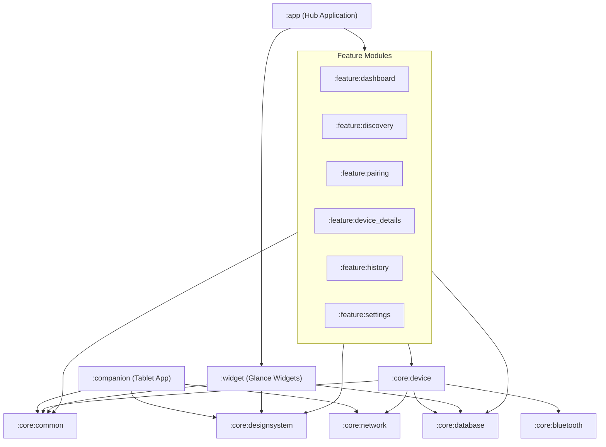
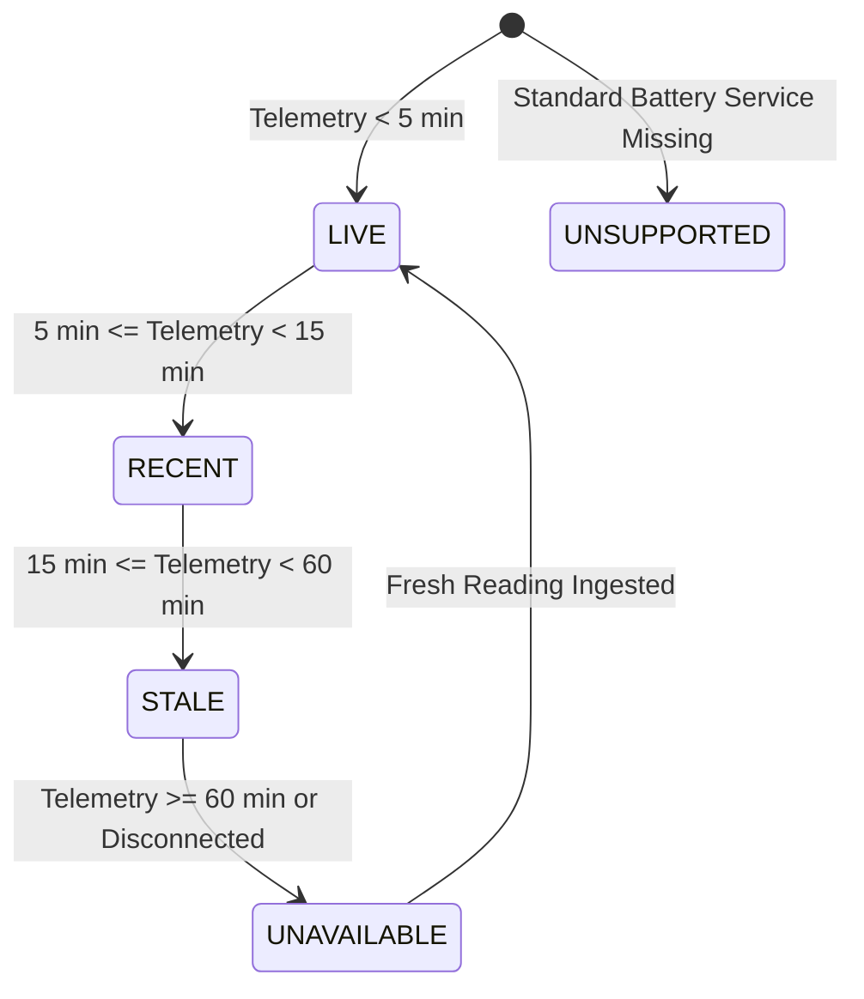

# ArBattery System Architecture

## 1. Executive Architectural Overview

**ArBattery** is an enterprise-grade, privacy-first, local-first Android multi-module battery monitoring ecosystem. It aggregates battery telemetry from diverse heterogeneous hardware—smartwatches, tablets, smartphones, and future desktop workstations—into a unified, real-time dashboard and native Jetpack Glance home screen widgets on a central Android smartphone (e.g., Samsung Galaxy A36 5G).

### Core Architectural Principles
1. **Privacy-First & Local-First**: No mandatory user accounts, no external cloud relays, and zero telemetry tracking. All communication occurs over direct Bluetooth Low Energy (BLE) or authenticated local area network (LAN) connections.
2. **Absolute Data Integrity (Zero Fabrication)**: Battery percentages and charging states are never fabricated, simulated, or assumed. If telemetry is unavailable, stale, or unsupported, the UI renders explicit diagnostic states (`--`, `STALE`, or `UNSUPPORTED`) with exact timestamps.
3. **Graceful Hardware Degradation**: Built to operate seamlessly from modern Android versions (Android 14/15, API 34/35) down to legacy target devices such as the Samsung Galaxy Tab A 8.0 (2019) running Android 9/10/11 (`minSdk = 24`).
4. **Modular Clean Architecture**: Strict separation of concerns across core domain, data, networking, presentation, and hardware integration modules.

---

## 2. Multi-Module Project Structure

The project is structured into 15 focused Gradle modules:



### Module Responsibilities

| Module | Namespace | Role & Responsibilities |
| :--- | :--- | :--- |
| **`:app`** | `com.arverse.arbattery` | Central Hub application entry point, Application class, Hilt dependency graph container, navigation root, and background worker initialization. |
| **`:companion`** | `com.arverse.arbattery.companion` | Lightweight standalone companion APK tailored for tablets (Galaxy Tab A 8.0) and secondary Android devices. Samples hardware `BatteryManager` intents and pushes authenticated telemetry to the Hub. |
| **`:widget`** | `com.arverse.arbattery.widget` | Jetpack Glance home-screen widgets (Small 2x2, Medium 4x2, Large 4x4) powered by WorkManager background sync and Room Flow queries. |
| **`:core:common`** | `com.arverse.arbattery.core.common` | Pure domain models (`DeviceBattery`, `ChargingState`, `ConnectionMethod`, `ReadingQuality`), `AppResult<T>`, battery math, and formatting utilities. |
| **`:core:database`** | `com.arverse.arbattery.core.database` | Room 2.6.1 SQLite persistence (`DeviceEntity`, `BatteryReadingEntity`, `PairingEntity`, `DeviceCapabilityEntity`), DAOs, migrations, and repository implementations. |
| **`:core:bluetooth`** | `com.arverse.arbattery.core.bluetooth` | BLE scanner (`BluetoothLeScanner`), connection manager (`BluetoothGatt`), standard GATT Battery Service reader (`0x180F`/`0x2A19`), and Hammer Ace diagnostic inspector. |
| **`:core:network`** | `com.arverse.arbattery.core.network` | Embedded Ktor CIO HTTP/WebSocket server running on the Hub, Ktor HTTP client on the Companion, cryptographic token management, and JSON serialization. |
| **`:core:designsystem`** | `com.arverse.arbattery.core.designsystem` | Samsung One UI 7 inspired design system: high-contrast dark/light theme, typography, circular battery gauges, animated linear bars, and standardized cards. |
| **`:core:device`** | `com.arverse.arbattery.core.device` | Universal battery coordination engine, device integration adapters (`StandardBleBatteryIntegration`, `AndroidCompanionIntegration`, `WindowsAgentIntegration`), and freshness evaluators. |
| **`:feature:dashboard`** | `com.arverse.arbattery.feature.dashboard` | Primary dashboard screen featuring hero battery cards, device category filtering, pull-to-refresh, and quick navigation. |
| **`:feature:discovery`** | `com.arverse.arbattery.feature.discovery` | Device discovery wizard: BLE scan with live RSSI, LAN companion pairing guide, and dedicated Hammer Ace BLE diagnostic probe. |
| **`:feature:pairing`** | `com.arverse.arbattery.feature.pairing` | Pairing hub: QR code generation (ZXing), 6-digit random PIN generator, and paired companions authorization manager. |
| **`:feature:device_details`**| `com.arverse.arbattery.feature.device_details`| Deep-dive device view: large circular gauge, 24-hour battery history Canvas graph, hardware telemetry specs, and device controls. |
| **`:feature:history`** | `com.arverse.arbattery.feature.history` | Telemetry analytics: device history filtering, 24-hour discharge KPI cards, grouped timeline events, and CSV export. |
| **`:feature:settings`** | `com.arverse.arbattery.feature.settings` | User preferences: configurable low (20%) and critical (10%) alert thresholds, sound/vibration toggles, embedded server port, and data retention rules. |

---

## 3. Clean Architecture & MVVM Pattern

Every feature module strictly adheres to Clean Architecture:

```
[UI Layer (Jetpack Compose Screen)]
           │
           ▼
[Presentation Layer (ViewModel + UI State Flow)]
           │
           ▼
[Domain / Integration Layer (UniversalBatteryManager / DeviceIntegration)]
           │
           ▼
[Data Layer (DeviceRepository / HistoryRepository / HubEmbeddedServer)]
           │
    ┌──────┴───────────────┐
    ▼                      ▼
[Local Room Database]   [Hardware IO (BLE / LAN Sockets)]
```

### Data Flow Lifecycle

1. **Discovery & Pairing**:
   - The user scans for BLE devices or launches the pairing screen on the Hub.
   - For BLE devices, `BluetoothLeScanner` streams advertised packets and UUIDs. Upon user confirmation, GATT connects and registers characteristic notifications.
   - For Wi-Fi companions, the Hub renders a QR code / 6-digit PIN containing its LAN IP, port, and pairing session nonce. The Companion submits an authenticated handshake request to `/api/v1/pairing/confirm`.
2. **Telemetry Ingestion**:
   - BLE devices push battery level notifications (`0x2A19`) or are periodically polled by `StandardBleBatteryIntegration`.
   - Android companions push batched telemetry packets to `/api/v1/devices/battery` via WorkManager or foreground service.
3. **Normalization & Storage**:
   - Ingested readings pass through `UniversalBatteryManager`.
   - The reading is validated (e.g., `0 <= batteryPercentage <= 100`, valid timestamp) and persisted into SQLite via `BatteryReadingDao` alongside updating the `DeviceEntity` master record.
4. **Reactive UI Streaming**:
   - Room queries expose reactive Kotlin `Flow<List<DeviceEntity>>`.
   - ViewModels map entities into domain `DeviceBattery` models with freshness evaluated (`LIVE`, `RECENT`, `STALE`, `UNAVAILABLE`).
   - Compose UI and Jetpack Glance widgets observe the state flow and re-render without manual polling.

---

## 4. Local Communication & Network Architecture

### Embedded Hub Server (`:core:network`)
The central smartphone executes an embedded **Ktor 2.3.12 CIO engine** HTTP server on configurable port `8443`.

```
                    LAN / Wi-Fi
Galaxy Tab A 8.0 ─────────────────► Samsung Galaxy A36 5G (Hub)
(Companion App)    POST /api/v1/battery   [Ktor CIO Server :8443]
                   Bearer Token: xyz                  │
                                                      ▼
                                              Room Database
```

#### Endpoints Specification

| Method | Path | Auth | Payload / Description |
| :--- | :--- | :--- | :--- |
| `POST` | `/api/v1/pairing/request` | Open | Initiates pairing handshake. Validates client public key and device identity. |
| `POST` | `/api/v1/pairing/confirm` | Nonce | Validates QR/PIN pairing code and issues persistent SHA-256 HMAC auth token. |
| `POST` | `/api/v1/devices/register`| Bearer | Registers new companion or agent metadata with the hub. |
| `POST` | `/api/v1/devices/battery` | Bearer | Ingests real-time battery telemetry (level, charging, voltage, temp, power source). |
| `GET`  | `/api/v1/devices`         | Bearer | Returns summary status of all registered ecosystem devices. |
| `GET`  | `/api/v1/devices/{id}`    | Bearer | Returns detailed status and last 24h readings for a specific device. |
| `DELETE`| `/api/v1/devices/{id}`   | Bearer | Revokes device credentials and unregisters device from hub. |
| `POST` | `/api/v1/sync`            | Bearer | Bidirectional telemetry and configuration synchronization. |

#### Security & Authentication Model
- **Replay-Resistant Nonces**: Pairing handshakes require short-lived, single-use cryptographic nonces.
- **HMAC-SHA256 Bearer Tokens**: Devices authenticate subsequent requests via HTTP `Authorization: Bearer <token>` headers validated against `PairingDao`.
- **IP & Subnet Whitelisting**: Requests are strictly bound to RFC 1918 private subnets (`192.168.x.x`, `10.x.x.x`, `172.16.x.x`). External public routing is rejected.

---

## 5. Battery Freshness Evaluation

To prevent misleading the user with outdated or frozen battery metrics, ArBattery enforces strict temporal freshness rules:



- **`LIVE`**: Telemetry received within the last 5 minutes. Displayed with solid vibrancy.
- **`RECENT`**: Telemetry received 5–15 minutes ago.
- **`STALE`**: Telemetry is between 15 and 60 minutes old. Displayed with a warning indicator and exact time elapsed.
- **`UNAVAILABLE`**: Device disconnected or telemetry exceeds 60 minutes. Percentage is retained with a disconnected badge; if never read, renders `--`.
- **`UNSUPPORTED`**: Device connects over BLE but lacks standard Battery Service `0x180F`.

---

## 6. Future Desktop Architecture: Windows Agent Protocol

For desktop integration (e.g., Windows 10/11 laptop), ArBattery defines a lightweight companion daemon:

1. **Transport**: Local Wi-Fi HTTP/WebSocket over mutual TLS (mTLS) or local token authentication.
2. **Telemetry Source**: Windows Runtime (`Windows.Devices.Power.BatteryReport`) or Win32 `GetSystemPowerStatus` API.
3. **Payload Structure**:
   ```json
   {
     "deviceId": "win-desktop-01",
     "deviceName": "ThinkPad-X1-Workstation",
     "deviceType": "LAPTOP",
     "batteryPercentage": 88,
     "chargingState": "CHARGING_AC",
     "connectionMethod": "WIFI",
     "timestamp": 1793340000,
     "telemetry": {
       "fullChargeCapacityMWh": 57000,
       "remainingCapacityMWh": 50160,
       "chargeRateMilliwatts": 42000,
       "estimatedRemainingMinutes": 145
     }
   }
   ```
4. **Integration Layer**: Handled identically via `WindowsAgentIntegration` in `:core:device`.
