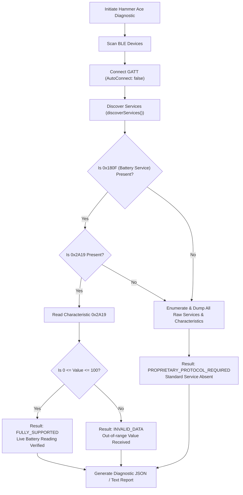

# Bluetooth Low Energy (BLE) Compatibility & Hammer Ace Diagnostic Architecture

## 1. Bluetooth SIG Standard Battery Profile

ArBattery implements full native compliance with the Bluetooth Special Interest Group (SIG) Battery Service specification.

### GATT UUID Constants

| Entity | UUID (128-bit) | 16-bit Short UUID | Properties |
| :--- | :--- | :--- | :--- |
| **Battery Service** | `0000180F-0000-1000-8000-00805F9B34FB` | `0x180F` | Primary Service |
| **Battery Level Characteristic** | `00002A19-0000-1000-8000-00805F9B34FB` | `0x2A19` | `READ`, `NOTIFY` |
| **Client Characteristic Configuration Descriptor (CCCD)** | `00002902-0000-1000-8000-00805F9B34FB` | `0x2902` | `READ`, `WRITE` |

### Value Representation & Normalization
The Battery Level characteristic contains a single unsigned 8-bit integer representing the percentage of remaining battery charge:
- Valid range: `0` to `100` (inclusive).
- Kotlin conversion:
  ```kotlin
  val rawByte = characteristic.value?.getOrNull(0) ?: return
  val percentage = rawByte.toInt() and 0xFF
  if (percentage in 0..100) {
      // Valid reading
  }
  ```
- Any value outside `0..100` is rejected as an invalid frame and logged to diagnostics.

---

## 2. Real-Time Telemetry via Notifications

When supported by the peripheral, ArBattery enables GATT notifications on characteristic `0x2A19` to eliminate aggressive periodic polling and conserve both phone and peripheral battery life:

1. **Enable Local Notification**:
   ```kotlin
   gatt.setCharacteristicNotification(batteryLevelChar, true)
   ```
2. **Configure Remote CCCD Descriptor (`0x2902`)**:
   ```kotlin
   val cccd = batteryLevelChar.getDescriptor(UUID.fromString("00002902-0000-1000-8000-00805F9B34FB"))
   if (Build.VERSION.SDK_INT >= Build.VERSION_CODES.TIRAMISU) {
       gatt.writeDescriptor(cccd, BluetoothGattDescriptor.ENABLE_NOTIFICATION_VALUE)
   } else {
       @Suppress("DEPRECATION")
       cccd.value = BluetoothGattDescriptor.ENABLE_NOTIFICATION_VALUE
       @Suppress("DEPRECATION")
       gatt.writeDescriptor(cccd)
   }
   ```
3. **Handle Updates**: Received updates in `BluetoothGattCallback.onCharacteristicChanged` are normalized and immediately dispatched to `UniversalBatteryManager`.

---

## 3. Hammer Ace Smartwatch Integration & Diagnostic Suite

### Hardware Context
The **Hammer Ace** is a popular smartwatch whose proprietary firmware implementation may or may not expose the standard SIG Battery Service `0x180F`. Rather than assuming support or hardcoding static fallback values, ArBattery implements a dedicated, non-invasive **Hammer Ace Diagnostic Workflow** (`HammerAceDiagnosticScanner`).



### Diagnostic Probing Architecture

The diagnostic engine executes an end-to-end audit:
1. **Device Identification**: Probes peripheral advertise data, device name, and MAC address.
2. **GATT Tree Walk**: Traverses all primary and secondary services, inspecting characteristic UUIDs and permissions (`READ`, `WRITE`, `NOTIFY`, `INDICATE`).
3. **Standard Battery Service Verification**:
   - Queries for `0x180F`.
   - If present, queries for `0x2A19`.
   - Attempts an initial read and validates whether the payload conforms to the unsigned byte standard.
4. **Diagnostic Export**: Generates structured JSON and human-readable audit logs containing:
   - Device Name & MAC Address
   - RSSI & Connection state
   - Full list of discovered GATT services & characteristics
   - Presence flags: `hasBatteryService`, `hasBatteryLevelCharacteristic`, `canRead`, `canNotify`
   - Initial read value (if successful) or error code
   - Export capability via Android Share Sheet (JSON or plain text)

### Graceful Fallback & Protocol Adapters

If the Hammer Ace firmware does not expose `0x180F`:
- The application **never fabricates a percentage**.
- The device state is marked as `UNSUPPORTED_STANDARD_SERVICE`.
- The UI presents the discovered GATT profile and characteristic handles.
- A plugin/protocol adapter architecture (`DeviceIntegration`) is provided, allowing future reverse-engineered or vendor-documented proprietary framing (e.g., DaFit, Realtek, or Nordic Semiconductor UART profile) to plug directly into the ecosystem without altering core logic.

---

## 4. Connection Lifecycle & Robustness

### Android Version Compatibility
- **Android 12+ (API 31+)**: Requires runtime permissions `BLUETOOTH_SCAN` (with `neverForLocation` flag where applicable) and `BLUETOOTH_CONNECT`.
- **Android 6 to 11 (API 23-30)**: Requires `ACCESS_FINE_LOCATION` and legacy `BLUETOOTH` / `BLUETOOTH_ADMIN`.
- **Samsung One UI Background Bleeding**: Implements explicit scan timeouts (default: 30 seconds) to prevent battery drain. Scanners are automatically unregistered on screen exit or connection establishment.

### GATT Status Error Recovery
- Status `133` (`GATT_ERROR`): Handled with exponential backoff and explicit `gatt.close()` prior to re-connection.
- Connection state change monitoring handles peripheral out-of-range events, transitioning reading status to `RECENT` -> `STALE` -> `UNAVAILABLE` while preserving the last legitimate timestamp.
