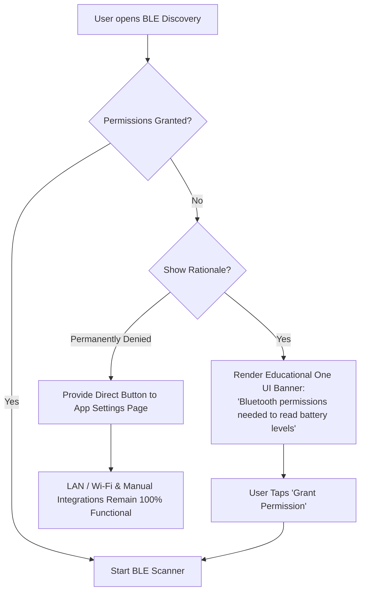

# Android Permissions Architecture & Compatibility Matrix

## 1. Overview

ArBattery interfaces with low-level Bluetooth radio hardware, local Wi-Fi networking sockets, and background telemetry daemons. Android's permission model has undergone significant security overhauls between API 24 (Android 7.0) and API 35 (Android 15). ArBattery manages these transitions through `BluetoothPermissionHelper` and adaptive manifest declarations, ensuring seamless backward and forward compatibility without runtime crashes.

---

## 2. Comprehensive Permissions Matrix

| Permission | Android Version | Manifest Declaration | Runtime Request | Operational Purpose |
| :--- | :--- | :--- | :--- | :--- |
| `BLUETOOTH_SCAN` | Android 12+ (API 31+) | `android:usesPermissionFlags="neverForLocation"` | Required at Runtime | Discovers nearby BLE peripherals (smartwatches, earbuds) without extracting geographic coordinates. |
| `BLUETOOTH_CONNECT` | Android 12+ (API 31+) | Standard | Required at Runtime | Establishes GATT connections, reads battery characteristics (`0x2A19`), and subscribes to notifications. |
| `BLUETOOTH_ADVERTISE` | Android 12+ (API 31+) | Standard | Optional / Diagnostic | Advertises hub presence over BLE where peripheral reverse-discovery is supported. |
| `ACCESS_FINE_LOCATION` | Android 6–11 (API 23–30) | `android:maxSdkVersion="30"` | Required at Runtime | Mandated by legacy Android to perform BLE scans, as beacons could theoretically infer physical location. |
| `ACCESS_COARSE_LOCATION` | Android 6–11 (API 23–30) | `android:maxSdkVersion="30"` | Required at Runtime | Fallback location permission for BLE scanning on older hardware. |
| `BLUETOOTH` | Android 6–11 (API 23–30) | `android:maxSdkVersion="30"` | Install-Time | Legacy permission to connect to paired Bluetooth devices. |
| `BLUETOOTH_ADMIN` | Android 6–11 (API 23–30) | `android:maxSdkVersion="30"` | Install-Time | Legacy permission to initiate device discovery and modify Bluetooth states. |
| `POST_NOTIFICATIONS` | Android 13+ (API 33+) | Standard | Required at Runtime | Alerts users when any tracked device crosses low (20%) or critical (10%) battery thresholds. |
| `INTERNET` | All (API 24+) | Standard | Install-Time | Binds embedded Ktor CIO server on port `8443` and handles LAN REST/WebSocket communication. |
| `ACCESS_NETWORK_STATE` | All (API 24+) | Standard | Install-Time | Inspects active Wi-Fi interface, subnet address, and link state. |
| `ACCESS_WIFI_STATE` | All (API 24+) | Standard | Install-Time | Resolves Hub and Companion IPv4 addresses for LAN pairing. |
| `CHANGE_WIFI_MULTICAST_STATE` | All (API 24+) | Standard | Install-Time | Enables zero-configuration local discovery (mDNS / NSD). |
| `FOREGROUND_SERVICE` | Android 9+ (API 28+) | Standard | Install-Time | Maintains uninterrupted GATT telemetry streaming and Ktor server execution. |
| `FOREGROUND_SERVICE_CONNECTED_DEVICE` | Android 14+ (API 34+) | Standard | Install-Time | Explicit foreground service type declaration mandated for Bluetooth communication on Android 14+. |
| `WAKE_LOCK` | All (API 24+) | Standard | Install-Time | Prevents CPU sleep during active battery telemetry synchronization bursts. |

---

## 3. The `neverForLocation` Flag on Android 12+

Prior to Android 12, Google required `ACCESS_FINE_LOCATION` to scan for Bluetooth devices. In Android 12 (API 31), Google decoupled Bluetooth from geographic location.

In ArBattery's `AndroidManifest.xml`:
```xml
<uses-permission
    android:name="android.permission.BLUETOOTH_SCAN"
    android:usesPermissionFlags="neverForLocation"
    tools:targetApi="s" />
```

### Architectural Implications:
1. **Privacy Guarantee**: By asserting `neverForLocation`, ArBattery guarantees to the Android OS that it does not use BLE scan results to derive physical user location.
2. **User Trust**: The user is presented with a clean "Allow ArBattery to find nearby devices" prompt rather than an invasive "Allow ArBattery to access your precise location" prompt.
3. **Hardware Filtering**: BLE beacon scanning (which transmits location coordinates) is automatically filtered out by the OS; direct peripheral scanning (GATT) remains fully operational.

---

## 4. Graceful Permission Degradation

If the user denies or revokes permissions, ArBattery **never crashes** and adapts dynamically:



1. **Bluetooth Disabled**:
   - The UI displays an inline banner: *"Bluetooth is turned off"*.
   - A direct action button triggers `BluetoothAdapter.ACTION_REQUEST_ENABLE`.
2. **Bluetooth Permissions Denied**:
   - BLE scanning is disabled; the BLE tab displays an informative guide with a "Grant Permission" button.
   - **Crucially, LAN synchronization, Companion tablet pairing, History analytics, and Home widgets remain 100% functional.**
3. **Notification Permission Denied**:
   - The application functions normally. In Settings, the threshold alert toggle displays a subtext: *"Notification permission is required to receive threshold alerts"*.
